# Звіт з лабораторної роботи №3

**Дисципліна:** Проектування інформаційних систем  
**Тема:** Організація життєвого циклу, планування та управління ризиками SDD-проєкту  
**Студент:** Андрій Волошин (гр. КН-31 / КН-21)  
**Кодинговий агент:** Antigravity AI Coding Assistant (Gemini 3.8 Flash)  
**Репозиторій проєкту:** [github.com/voloshyyn/web-app_for_design-references](https://github.com/voloshyyn/web-app_for_design-references)  
**Дата виконання:** 17 жовтня 2026 р.

---

## 1. Мета роботи та вхідні артефакти

**Мета:** Опанувати практичну трансформацію затвердженої специфікації вимог (SRS Baseline v1.0) на керований календарний план реалізації у парадигмі **Specification-Driven Development (SDD)**. Набути навичок декомпозиції вимог на SDD-тікети, моделювання життєвого циклу задачі в системі багтрекінгу, оптимізації взаємодії людини та ШІ-агента, розрахунку критичного шляху (CPM) з урахуванням людських обмежень пропускної здатності, а також сформувати реєстр класичних та ШІ-специфічних проєктних ризиків.

**Вхідні артефакти (сформовані та затверджені в ЛР2):**
- Базова специфікація вимог: `spec/srs.md` (версія 1.0, статус `APPROVED`).
- Глосарій єдиної мови предметної області: `spec/glossary.md`.
- Набір поведінкових сценаріїв Gherkin: `spec/bdd-scenarios.md` (`SCN-01` — `SCN-07`).
- Початкова матриця простежуваності: `spec/traceability-matrix.md`.
- Протокол проходження точки вимог: `logs/spec-gate.md`.

---

## 2. Опис налаштованого робочого процесу в системі багтрекінгу

Для управління реалізацією обрано екосистему **GitHub Issues & GitHub Projects**, що інтегрована безпосередньо з вихідним кодом проєкту.

### 2.1. Статуси задачі та правила переходів
Життєвий цикл кожної задачі формалізовано 6 основними та 2 винятковими станами:
1. `New / Draft` — задача ініціюється виключно на основі стабільного ID вимоги (`REQ-ID`) з SRS.
2. `Backlog / Planned` — задача валідована людиною, призначено виконавця, оцінено трудовитрати.
3. `In Progress (Dev / TDD)` — активна розробка. Для кодових задач діє **правило TDD-блокування**: кодування починається тільки за наявності готового й затвердженого тесту.
4. `Verification (CI / Testing)` — автоматизований прогін тестового набору `pytest`, контроль лінтингу коду та вимірювання затримки виконання (Latency SLA < 50 мс).
5. `Validation (Review / Stage-Gate)` — людський когнітивний аудит відповідності реалізації концепції та ухвалення рішення Gate.
6. `Done / Closed` — задача виконана, код влито в `main`, оновлено матрицю RTM.
7. `Blocked / Revise` — зупинка робіт у разі виявлення прогалин у специфікації (викликає створення Адендуму).
8. `Rejected` — задача скасована через відсутність обґрунтування у специфікації (захист від Gold Plating).

Графічне представлення життєвого циклу із зазначенням ролей наведено у векторному документі `docs/task-lifecycle-diagram.svg`.

---

## 3. Таблиця типів тікетів SDD та розподіл ролей

| Тип тікета | Префікс | Призначення | Основний виконавець | Роль студента (Lead) | Автономність ШІ |
|---|---|---|---|---|---|
| **Specification** | `SPEC-*` | Опис вимог, правил, меж v1.0 | Людина | Авторство та заморожування | Допоміжна |
| **Addendum** | `ADD-*` | Формальні зміни SRS після Gate | Людина | Авторизація змін меж | Заборонено створювати |
| **Test** | `TEST-*` | Розробка BDD/TDD-сценаріїв | ШІ-агент + Людина | Рев'ю тестів до коду | Висока (генерація pytest) |
| **Feature** | `FEAT-*` | Імплементація коду моделей | ШІ-агент | Архітектурний аудит, PR review | Висока (написання логіки) |
| **Verification** | `VERIF-*` | Авто-тести, coverage, SLA | CI / Авто-раннер | Моніторинг звітів | Повна (автономна) |
| **Validation** | `VALID-*` | Оцінка юзабіліті, перевірка UX | Людина | Головний оцінювач ергономіки | Консультативна |
| **Documentation**| `DOC-*` | Документація, RTM, керівництва | ШІ-агент + Людина | Фінальне затвердження тексту | Середня (генерація драфтів)|
| **Gate** | `GATE-*` | Рішення переходу (GO / REVISE) | Людина | **Виключне право рішення** | **Заборонено ухвалювати** |

---

## 4. Приклад декомпозиції ключових вимог

Усі 13 вимог SRS декомпозовано на атомарні тікети. Приклад декомпозиції для репрезентативних вимог:

1. **Вимога `REQ-F-001` (Створення референсу) та `REQ-NF-004` (Безпека вхідних URL):**
   - `TEST-01` (Тип `Test`, роль `Joint`, 1.0 год): Розробка тестів валідації полів та сценарію блокування небезпечних протоколів (`javascript:`, `data:`) за сценаріями `SCN-01`, `SCN-02`.
   - `FEAT-01` (Тип `Feature`, роль `AI Agent`, 0.7 год): Імплементація класу `Reference` у `src/models.py` з вбудованим валідатором URL. Заблокована до завершення `TEST-01`.
2. **Вимога `REQ-F-002` (Категорії) та `REQ-NF-003` (Цілісність даних):**
   - `TEST-02` (Тип `Test`, роль `AI Agent`, 0.5 год): Розробка тесту переасоціації референсів до категорії `General` при видаленні поточної (`SCN-05`).
   - `FEAT-02` (Тип `Feature`, роль `AI Agent`, 0.6 год): Реалізація зв'язку 1:1 та методу безпечного каскадного відкату.
   - `GATE-CORE` (Тип `Gate`, роль `Human`, 0.9 год): Контрольна точка аудиту безпеки та цілісності ядра.
3. **Вимога `REQ-F-004, 005` (Теги, фасети) та `REQ-NF-001` (SLA швидкодії):**
   - `TEST-03` (Тип `Test`, роль `AI Agent`, 0.6 год): Тести розбору фасетів `namespace:value`, перетину множин тегів та бенчмарк Latency < 50 мс (`SCN-03`, `04`).
   - `FEAT-03` (Тип `Feature`, роль `AI Agent`, 0.8 год): Реалізація фасетного пошукового індексатора в `Catalog.filter_by_tags`.

---

## 5. Граф залежностей та календарний план робіт

```mermaid
gantt
    title Календарний план реалізації проєкту web-app_for_design-references
    dateFormat  X
    axisFormat %s год
    
    section Фаза 0: Планування
    Аудит SRS та меж [SPEC-BASE] :crit, spec, 0, 1.2
    Контрольна точка PLAN-GATE :crit, gate1, after spec, 0.6
    
    section Фаза 1: Ядро та Безпека
    Тести валідації та XSS [TEST-01] :crit, t1, after gate1, 1.0
    Реалізація Reference [FEAT-01] :crit, f1, after t1, 0.7
    Тести цілісності Fallback [TEST-02] :t2, after t1, 0.5
    Реалізація Категорій [FEAT-02] :crit, f2, after f1, 0.6
    Контрольна точка CORE-GATE :crit, gate2, after f2, 0.9
    
    section Фаза 2: Фасети та Пошук
    Тести фасетів та SLA [TEST-03] :crit, t3, after gate2, 0.6
    Реалізація фільтрації [FEAT-03] :crit, f3, after t3, 0.8
    Тести пошуку та колекцій [TEST-04] :t4, after t3, 0.6
    Реалізація Catalog CRUD [FEAT-04] :crit, f4, after f3, 0.9
    
    section Фаза 3: Валідація та Реліз
    Авто-верифікація CI Suite [VERIF-ALL] :crit, v1, after f4, 0.5
    Валідація людиною UX [VALID-UX] :crit, val, after v1, 1.1
    Документація та RTM [DOC-RTM] :crit, doc, after val, 1.0
    Контрольна точка RELEASE-GATE :crit, gate3, after doc, 0.6
```

---

## 6. Розрахунок критичного шляху (CPM) та аналіз людського фактора

Розрахунок проведено автоматизованим скриптом `scripts/calculate_cpm_and_gantt.py`.

### 6.1. Математичні показники графіка робіт
- **Загальна календарна тривалість (Critical Path):** **10.50 годин**.
- **Сумарні трудовитрати:** **11.60 людино-годин**.
  - Трудовитрати ШІ-кодингового агента: **4.60 год (39.7%)**.
  - Трудовитрати людини (інженера/ліда): **7.00 год (60.3%)**.

### 6.2. Задачі критичного шляху ($Slack = 0$)
Критичний ланцюг, затримка будь-якої ланки якого призводить до прямого зриву дедлайну проєкту:
$$\text{SPEC-BASE} \rightarrow \text{GATE-PLAN} \rightarrow \text{TEST-01} \rightarrow \text{FEAT-01} \rightarrow \text{FEAT-02} \rightarrow \text{GATE-CORE} \rightarrow \text{TEST-03} \rightarrow \text{FEAT-03} \rightarrow \text{FEAT-04} \rightarrow \text{VERIF-ALL} \rightarrow \text{VALID-UX} \rightarrow \text{DOC-RTM} \rightarrow \text{GATE-FINAL}$$

### 6.3. Людські дії як головне «вузьке місце» (Human Bottleneck)
ШІ-агент виконує технічні операції кодування за лічені хвилини. Проте розрахунок показав, що **60.3% тривалості проєкту припадає на людські дії** (рецензування специфікації, валідація ергономіки, ручний аудит негативних тестів на ін'єкції та рішення на 3-х контрольних точках Gate). Таким чином, саме швидкість і якість роботи людини є обмежувачем загальної пропускної здатності SDD-конвеєра.

---

## 7. Порівняння: Пропозиція агента vs Корективи студента

| Елемент плану | Що запропонував ШІ-агент | Які корективи вніс студент | Обґрунтування інженерного рішення |
|---|---|---|---|
| **Структура тікетів** | Об'єднані задачі `TASK-01..08` (код + тести разом) | Жорсткий поділ на `TEST-*` та `FEAT-*` | Реалізація принципу TDD: кодування блокується до написання тесту |
| **Контрольні точки** | Лише один Gate наприкінці релізу | Додано проміжну точку `GATE-CORE` | Захист від критичних відмов у безпеці (`REQ-NF-004`) та цілісності (`REQ-NF-003`) |
| **Кореляція помилок** | Повна генерація коду і тесту одним промптом | Спільний режим `Joint` для задач безпеки | Запобігання ситуації, коли агент підганяє тест під власний баг |
| **Оцінка строків** | Однаковий час (0.5 год) на всі задачі | Збільшено час людини на Stage-Gates | Врахування когнітивного навантаження людини на критичному шляху |

---

## 8. Реєстр ризиків проєкту (Класичні та ШІ-специфічні)

Усі ризики зафіксовано в `docs/risk-register.md`. Нижче наведено зведення найбільш критичних факторів:

1. **ШІ: Кореляція помилок між тестом і кодом (False-Positive Trap, Ранг 20 - CRITICAL):**
   - *Прояв:* ШІ генерує код із прихованим логічним дефектом і створює тавтологічний тест, що підтверджує цю помилку.
   - *Запобігання:* Розробка тестів для зон високої ціни відмови ведеться в режимі `Joint` із ручною верифікацією тест-кейсів інженером до генерації коду.
2. **ШІ: Розповзання меж та Gold Plating (Ранг 12 - HIGH):**
   - *Прояв:* Самовільне додавання агентом функцій комп'ютерного зору або складних таксономій.
   - *Запобігання:* Автоматичне блокування та статус `REJECTED` для задач без відповідного ID у базовій SRS v1.0.
3. **Традиційний: Вразливість URL/XSS (REQ-NF-004, Ранг 10 - HIGH):**
   - *Прояв:* Проникнення шкідливого коду через псевдопротоколи `javascript:`.
   - *Запобігання:* Обов'язковий сценарій `SCN-02`, регулярні вирази санітизації та окрема перевірка на `GATE-CORE`.
4. **Традиційний: Втрата даних при видаленні категорій (REQ-NF-003, Ранг 10 - HIGH):**
   - *Прояв:* Каскадне видалення референсів користувача.
   - *Запобігання:* Архітектурний механізм `Fallback to General`, гарантований тестом `SCN-05`.

---

## 9. Результати проходження PLAN-GATE

Контрольна точка **PLAN-GATE** успішно пройдена та зафіксована в протоколі `logs/plan-gate.md`:
- **Статус рішення:** **APPROVED (GO)**.
- **Підстава:** 100% двонаправлена простежуваність між SRS v1.0 та тікетами беклогу, відсутність gold plating, наявність контрольних шлюзів у критичних місцях архітектури, визначеність заходів контролю ризиків.
- Розблоковано виконання тікетів реалізації першого спринту.

---

## 10. Висновки

У ході виконання лабораторної роботи №3 повністю реалізовано календарне планування та організацію життєвого циклу SDD-проєкту.

**Основні результати:**
1. Налаштовано процес трекінгу задач на базі GitHub Issues з використанням стандартних типів тікетів SDD.
2. Проведено декомпозицію 13 вимог специфікації SRS v1.0 на керовані одиниці робіт і синхронізовано матрицю простежуваності `spec/traceability-matrix.md`.
3. Розроблено та експортовано векторну діаграму станів життєвого циклу задачі (`docs/task-lifecycle-diagram.svg`) з явним позначенням ролей на кожному переході.
4. Побудовано графік робіт у форматі діаграми Ганта та виконано розрахунок критичного шляху методом CPM (тривалість 10.5 год).
5. Доведено ключову роль людського фактора (Human-in-the-loop bottleneck, 60.3% трудовитрат) в умовах використання швидкісного ШІ-кодингового агента.
6. Сформовано всебічний реєстр ризиків з акцентом на специфіку LLM (пастка кореляції помилок, розмиття контексту) та затверджено резолюцію PLAN-GATE (GO).
