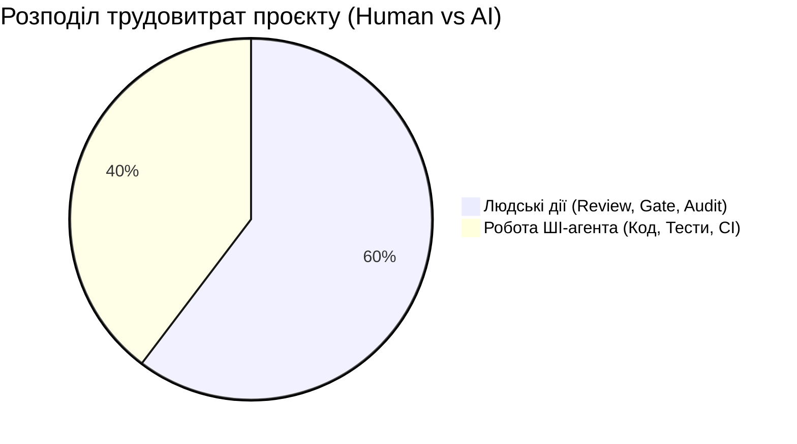

# Реєстр ризиків SDD-проєкту (Risk Register)

- **Проєкт:** Система каталогізації та швидкого пошуку дизайн-референсів (`web-app_for_design-references`)
- **Етап:** Організація життєвого циклу та планування (Лабораторна робота №3, точка PLAN-GATE)
- **Методологія аналізу:** Оцінка ймовірності ($P$) та впливу ($I$) за шкалою $1..5$ ($R = P \times I$), класифікація на традиційні та ШІ-специфічні ризики.

---

## 1. Зведена матриця ризиків проєкту

| ID Ризику | Категорія | Найменування ризику | Ймовірність (P: 1-5) | Вплив (I: 1-5) | Ранг (R = P×I) | Рівень критичності | Пов'язані вимоги / Компоненти |
|---|---|---|---|---|---|---|---|
| **RSK-AI-01** | ШІ-конвеєр | Кореляція помилок між кодом і тестом, створеними одним агентом | 4 | 5 | **20** | **CRITICAL** | `REQ-F-001`, `REQ-NF-004` (Валідація безпеки) |
| **RSK-AI-02** | ШІ-конвеєр | Неправильне тлумачення вимог та самовільний Gold Plating | 3 | 4 | **12** | **HIGH** | `REQ-F-004`, `REQ-F-005` (Синтаксис фасетів) |
| **RSK-AI-03** | ШІ-конвеєр | Втрата або застарівання контексту (Context Drift / Dilution) | 4 | 3 | **12** | **HIGH** | Архітектурна цілісність, `models.py` |
| **RSK-AI-04** | ШІ-конвеєр | Недетермінованість кодогенерації та регресії у залежностях | 3 | 3 | **9** | **MEDIUM** | `src/models.py`, `tests/` |
| **RSK-AI-05** | ШІ-конвеєр | Помилки при взаємодії з інструментами та оточенням (Tool Misuse) | 2 | 3 | **6** | **LOW** | Git CLI, шляхи до файлів, кодування UTF-8 |
| **RSK-TR-01** | Традиційний | Руйнування цілісності даних при видаленні категорій (Висока ціна відмови) | 2 | 5 | **10** | **HIGH** | `REQ-F-002`, `REQ-NF-003` (Reliability) |
| **RSK-TR-02** | Традиційний | Проникнення XSS / Malicious Schemes через вхідний URL (Висока ціна відмови) | 2 | 5 | **10** | **HIGH** | `REQ-F-001`, `REQ-NF-004` (Security) |
| **RSK-TR-03** | Традиційний | Недооцінка людського «вузького місця» (Human Stage-Gate Bottleneck) | 4 | 3 | **12** | **HIGH** | Графік розробки, календарний дедлайн |
| **RSK-TR-04** | Традиційний | Недотримання SLA швидкодії пошуку при зростанні бази (> 1000 ел.) | 2 | 4 | **8** | **MEDIUM** | `REQ-F-005`, `REQ-NF-001` (Latency < 50ms) |

---

## 2. Детальний аналіз специфічних ризиків ШІ-конвеєра

### RSK-AI-01: Кореляція помилок між тестом і кодом (False-Positive Trap)
- **Прояв:** ШІ-агент формулює хибне припущення щодо бізнес-правила (наприклад, дозволяє відносні шляхи в URL). Оскільки той самий агент пише і модульний тест, і код реалізації, він підганяє асерти тесту під власну дефектну логіку. Усі тести проходять («зелені»), створюючи ілюзію повної надійності.
- **Можливі наслідки:** Проникнення критичних вразливостей (Stored XSS, обхід санітизації) у стабільну гілку `main`.
- **Спосіб виявлення:** Незалежний аудит тест-кейсів людиною до написання коду; застосування мутаційного тестування (Mutation Testing).
- **Заходи пом'якшення:** Сегрегація промптів: розробка тесту ведеться в спільному режимі `Joint`, де людина верифікує граничні випадки сценарію (`TEST-01`) до запуску кодогенерації `FEAT-01`.

### RSK-AI-02: Неправильне тлумачення вимог та самовільний Gold Plating
- **Прояв:** Агент домальовує функціональність, якої немає в SRS (наприклад, складне дерево таксономій або складні алгоритми комп'ютерного зору замість простого текстового тегу `namespace:value`).
- **Можливі наслідки:** Розповзання меж проєкту (Scope Creep), порушення принципу Zero-Friction UX, перевитрата часу.
- **Спосіб виявлення:** Автоматизоване зіставлення дифу коду з критеріями прийняття (AC) та RTM; процедура ручної валідації `VALID-UX`.
- **Заходи пом'якшення:** Жорстке зв'язування кожного тікета з ID вимоги (`REQ-ID`). Заборона прийняття коду, який не має відповідника в SRS (рішення `REJECTED`).

### RSK-AI-03: Втрата або застарівання контексту (Context Window Decay)
- **Прояв:** При тривалих сесіях розробки агент забуває глобальні конвенції (конвенцію комітів `docs/git-workflow.md`, обмеження in-memory сховища) і починає перезаписувати або дублювати методи у `src/models.py`.
- **Можливі наслідки:** Логічні конфлікти, зникнення раніше реалізованих функцій, спагетті-код.
- **Спосіб виявлення:** Моніторинг розміру дифу та історії комітів; виконання димових тестів `tests/test_smoke.py`.
- **Заходи пом'якшення:** Атомарна декомпозиція: передача агенту виключно локального контексту поточного тікета разом з відповідним фрагментом SRS.

### RSK-AI-04: Недетермінованість кодогенерації
- **Прояв:** При повторному перезапуску генерації однієї й тієї ж задачі агент генерує синтаксично відмінний код з різними структурами даних (наприклад, змінює тип `tags` із `set` на `list`).
- **Можливі наслідки:** Нестабільність збірок, приховані баги інтеграції між компонентами.
- **Спосіб виявлення:** Фіксація типів даних за допомогою Python Type Hints та static-checking (mypy).
- **Заходи пом'якшення:** Заморожування інтерфейсів у глосарії та суворі сигнатури функцій у специфікації.

### RSK-AI-05: Помилки взаємодії з інструментами та оточенням
- **Прояв:** Проблеми кодування символів Windows-1251 / UTF-8 у консолі PowerShell, неправильні відносні шляхи до артефактів.
- **Можливі наслідки:** Збій автоматизованих скриптів, блокування конвеєра.
- **Спосіб виявлення:** Автоматичний моніторинг exit code у скриптах.
- **Заходи пом'якшення:** Використання абсолютних шляхів і стандартних бібліотек Python (`pathlib`, `subprocess`).

---

## 3. Аналіз вимог з високою ціною відмови (High Cost of Failure)

Деякі вимоги несуть непропорційно високі ризики для життєздатності продукту. Для них запроваджено посилений багатошаровий контроль:

### 1. REQ-NF-004 (Безпека протоколів та захист від ін'єкцій)
- **Ціна відмови:** Виконання шкідливого JavaScript-коду в браузері користувача через вектор `javascript:alert(document.cookie)` у полі URL.
- **Заходи посиленого контролю:**
  - Окремий BDD-сценарій негативного тестування `SCN-02` із переліком заборонених векторів (`javascript:`, `data:`, `ftp://`).
  - Тікет `TEST-01` має статус спільного виконання (`Joint`) з обов'язковим ручним рев'ю тест-векторів інженером.
  - Обов'язкова контрольна точка **CORE-GATE** перед переходом до другого спринту.

### 2. REQ-NF-003 (Цілісність даних при каскадному видаленні категорій)
- **Ціна відмови:** Безповоротна втрата референсів користувача при видаленні батьківської категорії (0% толерантність до втрати даних).
- **Заходи посиленого контролю:**
  - Архітектурний патерн `Fallback to General`: автоматична переасоціація референсів без видалення об'єкта.
  - BDD-тест `SCN-05`, що верифікує збереження 100% атрибутів референсу після ліквідації категорії.
  - Блокування релізу на рівні `GATE-CORE` у разі виявлення каскадного видалення.

---

## 4. Оцінка людських дій як обмеження пропускної здатності (Human-in-the-Loop Bottleneck)

Математичний розрахунок CPM засвідчив:
- **Час роботи ШІ-агента:** 4.60 год (39.7% сумарних трудовитрат).
- **Час роботи людини:** 7.00 год (60.3% сумарних трудовитрат).

**Висновок:** Швидкість генерації коду агентом (хвилини) не є лімітуючим фактором. Головним лімітуючим фактором є людська пропускна здатність на контрольних точках `SPEC-BASE`, `GATE-PLAN`, `GATE-CORE`, `VALID-UX` та `GATE-FINAL`. Будь-яка оптимізація строків має бути спрямована на якісну структуризацію подачі артефактів людині, а не на подальше прискорення генератора коду.
